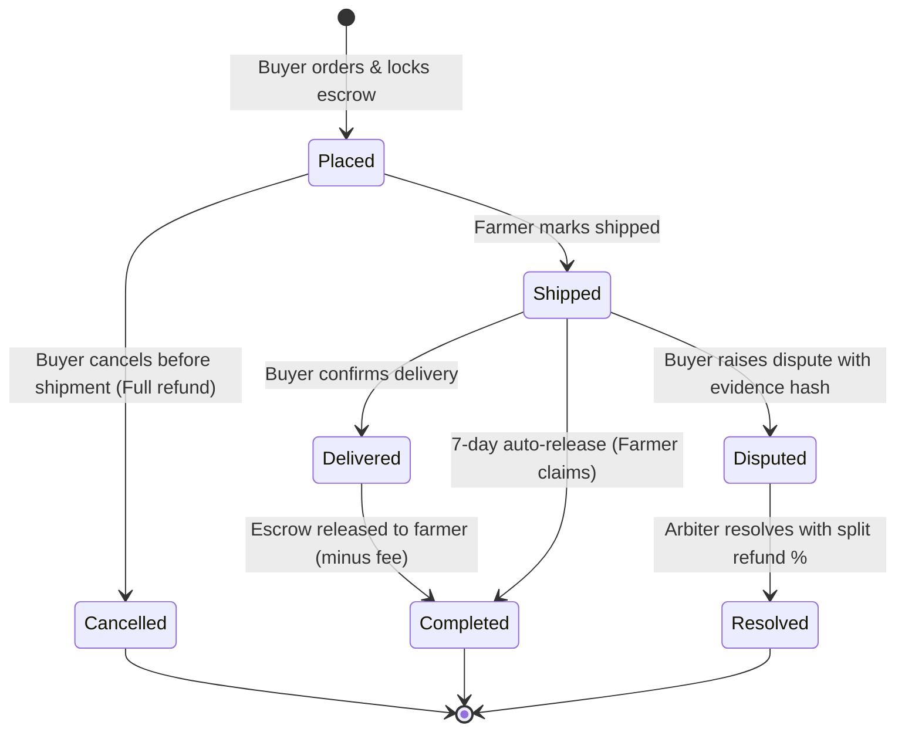

# Farmer-to-Buyer Marketplace with Escrow

A trustless, decentralized agricultural marketplace and escrow system built on Ethereum. Verified farmers list agricultural batches with quality provenance metadata, while verified buyers purchase produce with payment tokens locked in escrow. Escrow funds are automatically settled upon delivery confirmation, protected by a 7-day auto-release fallback and an arbiter-guided dispute resolution mechanism.

---

## Order State Machine



---

## Contracts Overview

1. **`UserRegistry.sol`**  
   Manages user registration for `FARMER`, `BUYER`, and `TRANSPORTER` roles with admin verification, ensuring only vetted actors participate across the marketplace.

2. **`MockStablecoin.sol`**  
   An ERC-20 payment token (6 decimals, symbol `mUSD`) with a public mint function for test and demonstration workflows.

3. **`Marketplace.sol`**  
   The core contract integrating produce batch listings, buyer orders, and escrow custody with a strictly enforced state machine, 7-day auto-release, and arbiter split resolution.

4. **`SupplyChainTracker.sol`**  
   Records timestamped transit telemetry (location, temperature, note IPFS hash) logged by authorized transporters, with read access restricted to order participants.

---

## On-Chain vs Off-Chain Data Architecture

To optimize gas efficiency and preserve privacy:
- **On-Chain Data:** Batch quantities, unit pricing, order financial totals, timestamps, state transitions, wallet role verifications, and cryptographic content hashes (`metadataHash`, `disputeEvidenceHash`, `noteHash`).
- **Off-Chain Data (IPFS / decentralized storage):** High-resolution crop imagery, soil reports, organic certification PDFs, detailed buyer/farmer personal information, and full IoT sensor telemetry payloads referenced solely by their immutable IPFS hashes on-chain.

---

## Quickstart & Commands

### Prerequisites
- Node.js (v18+)
- npm

### 1. Install Dependencies
```bash
npm install
```

### 2. Compile Contracts
```bash
npx hardhat compile
```

### 3. Run Test Suite (12 Core Tests)
```bash
npx hardhat test
```

### 4. Deploy Locally
```bash
npx hardhat run scripts/deploy.js
```

### 5. Run Full End-to-End Demo
```bash
npx hardhat run scripts/demo.js
```

---

## Limitations & Future Work

- **Decentralized Oracles & IoT Integration:** Automate temperature alerts and checkpoint logging via Chainlink Functions or direct hardware oracle nodes.
- **On-Chain Farmer & Transporter Reputation:** Implement non-transferable (soulbound) performance metrics based on timely deliveries and low dispute ratios.
- **Parametric Crop Insurance:** Integrate decentralized weather triggers to automatically payout escrow adjustments in extreme climate events.
- **Testnet & Layer-2 Deployment:** Deploy to Arbitrum Sepolia or Base Sepolia for low gas transaction fees and faster block confirmations.

